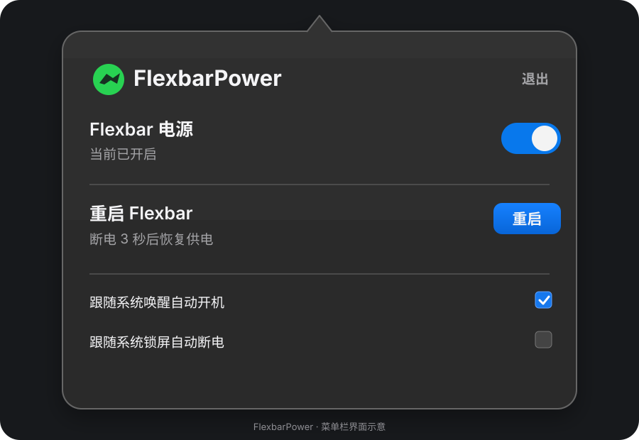

# FlexbarPower

FlexbarPower 是一个 macOS 菜单栏应用，用来控制连接在可切换 USB Hub 端口上的 Flexbar。

> **开发与验证范围：目前只基于 Mac mini M4（Mac16,10）开发。** 其他 Mac 型号、USB Hub、macOS 版本和 Flexbar 接线方式尚未验证。

## 界面预览



面板提供电源开关、三秒重启，以及两项可选的系统锁定/解锁自动化。底部复选框与按钮右侧对齐。

## 功能

- **手动开关电源**：通过 USB Hub 的指定端口给 Flexbar 断电或恢复供电。
- **重启 Flexbar**：关闭端口供电，等待 3 秒后恢复供电；菜单栏图标会同步显示进度。
- **解锁后自动开机**：勾选后，收到 macOS 屏幕解锁通知时，如果 Flexbar 当前断电，就恢复供电。
- **锁屏时自动断电**：勾选后，收到 macOS 屏幕锁定通知时，如果 Flexbar 当前有电，就关闭供电。
- **独立记忆两个选项**：自动开机和自动断电分别保存，可以单独启用。
- **菜单栏常驻**：点击菜单栏图标打开小面板；不需要主窗口常驻。

两项自动化需要 FlexbarPower 在用户登录后保持运行，才能接收锁屏和解锁通知。它们不会在 Mac 重启时自动启动应用，也不会把 Flexbar 的真实 USB 设备身份作为匹配条件。

## 供电控制原理

应用当前按固定 USB Hub 路径执行 `uhubctl` 命令：

```text
Hub location: 2-1
Port:         2
uhubctl:      /opt/homebrew/bin/uhubctl
```

状态读取、开关和重启分别对应以下参数：

```sh
uhubctl -l 2-1 -p 2
uhubctl -l 2-1 -p 2 -a on
uhubctl -l 2-1 -p 2 -a off
uhubctl -l 2-1 -p 2 -a cycle -d 3
```

因此当前实现是**控制固定 Hub 端口**，并非通过 Flexbar 的 VID/PID 自动识别设备。只有当 Flexbar 独占该可切换端口，且 Hub 支持 USB 端口供电切换时，端口断电才会让 Flexbar 真正断电。不同接线或 Hub 枚举路径可能需要修改 `Sources/FlexbarPowerHelper.swift` 中的 `-l` 和 `-p` 参数。

## 权限与进程结构

普通菜单栏应用不直接以 root 身份运行。第一次需要安装辅助程序时，应用会请求 macOS 管理员授权，并安装一个 LaunchDaemon：

1. 菜单栏应用通过 Mach 服务 `local.flexbar.power.helper` 发出状态查询、开机、断电或重启请求。
2. LaunchDaemon 以 root 身份运行 `FlexbarPowerHelper`，由它调用 `uhubctl` 操作 USB Hub。
3. 辅助程序对单条 `uhubctl` 命令设置 15 秒超时；超时会终止进程并返回错误。
4. 管理员密码只用于首次安装/更新系统级辅助程序，不会保存到项目中。

系统级文件位置：

```text
/Library/PrivilegedHelperTools/local.flexbar.power.helper
/Library/LaunchDaemons/local.flexbar.power.helper.plist
```

## 锁屏与解锁自动化

应用通过 `DistributedNotificationCenter` 监听 macOS 的 `com.apple.screenIsLocked` 和 `com.apple.screenIsUnlocked` 通知。收到通知后，先读取端口状态，只在实际状态与选项要求不一致时切换电源。单纯亮屏不会触发解锁自动开机。

这两个通知由系统发出，但不是本项目提供的跨版本稳定 API 契约。因此目前只将其作为 Mac mini M4 开发环境的实现方式；不同 macOS 版本上的通知时机和送达行为仍需验证。

## 构建要求

- Apple Silicon Mac；本项目当前仅基于 Mac mini M4 开发
- macOS 13 或更新版本（项目最低部署目标）
- Xcode Command Line Tools（提供 `swiftc`）
- Homebrew 安装的 `uhubctl`，路径为 `/opt/homebrew/bin/uhubctl`
- 支持可切换 USB 端口供电的 Hub，并将 Flexbar 接到项目配置的 Hub 端口

构建应用包：

```sh
./Scripts/build.sh
./Scripts/package-zip.sh
```

应用包位于 `build/FlexbarPower.app`，ZIP 位于 `artifacts/FlexbarPower-0.1.0-macOS-arm64.zip`。构建脚本会生成菜单栏应用、root 辅助程序、LaunchDaemon 配置，并对应用包做本机 ad-hoc 签名。它不会自动安装到 `/Applications` 或写入系统目录。

## 下载与安装

从 GitHub 的 **Releases** 下载 `FlexbarPower-0.1.0-macOS-arm64.zip`，解压后将 FlexbarPower 拖到“应用程序”文件夹。首次启动时需要管理员密码，应用用它安装上述辅助程序。安装前请确认 Flexbar 接在 `2-1` 的 2 号端口。

此安装包为 ad-hoc 签名，尚未使用 Apple Developer ID 签名或公证。macOS Gatekeeper 可能拦截首次启动；该发布包不应被当作经过 Apple 公证的发行版。应用及其管理员辅助程序的源码均在仓库中，授权前请先审阅。

## 目录结构

```text
Sources/
  FlexbarPower.swift              菜单栏界面、状态模型、自动化通知和 XPC 客户端
  FlexbarPowerHelper.swift        root XPC 服务与 uhubctl 调用
Resources/
  Info.plist                      macOS 应用包信息
  local.flexbar.power.helper.plist LaunchDaemon 配置
  FlexbarPower.icns               应用图标
  FlexbarPower.png                图标预览
  FlexbarPower.svg                图标矢量源文件
Scripts/
  build.sh                        本地构建脚本
  package-zip.sh                  生成保留 macOS 应用元数据的 ZIP 包
docs/
  ui-preview.svg                  菜单栏面板界面示意
```

## 当前限制

- 当前 USB Hub 路径和端口写死为 `2-1` / `2`，不是自动发现 Flexbar。
- 目前只基于 Mac mini M4 开发，不能据此推断其他 Mac 机型或 Hub 均兼容。
- 自动锁屏/解锁依赖系统分布式通知；当前没有为其他 macOS 版本做兼容性矩阵。
- 应用源代码里保留了 macOS 原生 `NSTouchBar` 实验代码；它控制的是 Mac 内建 Touch Bar API，不是外接 Flexbar 屏幕。外接 Flexbar 的 FlexDesigner 插件目前不包含在本仓库中。
- 项目尚未指定开源许可证；在添加许可证前，请勿将其视为已授予再发布或修改授权。

## 安全说明

安装辅助程序会修改 `/Library/PrivilegedHelperTools` 和 `/Library/LaunchDaemons`，需要管理员密码。请在确认代码来源可信后再运行应用并授权。构建和使用前，也请确认 `uhubctl -l 2-1 -p 2` 指向的是 Flexbar 所连接的端口。
